  

# 🛡️ Awesome Data Privacy & PII Redaction 

> A curated list of **Data Privacy**, **PII Redaction**, **LLM Prompt Sanitization**, and **De-Identification** tools, frameworks, and enterprise SaaS platforms.

  
  
  
  
  
  
  

---

## 📌 Executive Summary & Focus

This repository tracks notable **SaaS platforms** and **open-source projects** for **Data Privacy & PII Redaction**. These tools enable engineering teams, security professionals, and AI practitioners to detect, mask, anonymize, and remove personally identifiable information (PII/PHI/PCI) before sensitive data reaches Large Language Models (LLMs), external APIs, or data lakes.

**Key Architectural Themes:**
- 🔒 **Local-First & Zero-Trust Redaction**: In-flight masking with zero cloud telemetry.
- 🔄 **Reversible Tokenization**: Bi-directional masking preserving conversational context across turns.
- 🛡️ **Autonomous Agent Boundary Protection**: Fail-closed MCP servers and proxy gateways.
- 📊 **Enterprise DSPM & Governance**: Continuous discovery, polymorphic encryption, and regulatory audit trails.

---

## 📑 Table of Contents

- [📈 Sector Overview & Market Dynamics](#-sector-overview--market-dynamics)
- [🏢 SaaS/Hosted Platforms](#-saashosted-platforms)
- [💻 Open-Source GitHub Projects](#-open-source-github-projects)
- [🤝 How to Contribute](#-how-to-contribute)
- [💖 Support & Sponsorship](#-support--sponsorship)
- [⭐ Star History](#-star-history)
- [⚠️ Disclaimer](#️-disclaimer)

---

## 📈 Sector Overview & Market Dynamics

The global Data Security Posture Management (DSPM) and data privacy software market is estimated between **$1.1B and $2.5B**, expanding rapidly toward tens of billions at an estimated 25–31% CAGR driven by generative AI adoption, RAG pipelines, and stringent global privacy mandates (GDPR, HIPAA, CCPA, EU AI Act). 

The market is **moderately concentrated**: while specialized redaction point solutions create initial fragmentation, enterprise procurement is dominated by a concentrated core of cybersecurity and data governance heavyweights consolidating DSPM, identity security, dynamic masking, and privacy vault capabilities.

---

## 🏢 SaaS/Hosted Platforms

| Product | Company Size / Valuation | Pricing | Free Tier Limits | Key Capabilities & Best For |
|---|---|---|---|---|
| **CyberArk** | ~$20.6B Market Cap (NASDAQ: CYBR) | From ~$2,400–$4,800/privileged user/yr; Endpoint Privilege Manager from $30/endpoint/yr; secrets manager from $40/workload identity/yr (~$25,000/yr typical minimum contract) | 30-day proof-of-concept / evaluation trial via sales engagement (no permanent free tier) | Enterprise identity security, privileged access management, secret governance, and data boundary protection across hybrid cloud infrastructure. |
| **Varonis** | ~$5.6B Market Cap (NASDAQ: VRNS) | From ~$55–$140/user/yr (typical entry enterprise contracts start around $15,000–$25,000/yr) | 30-day free trial with complimentary automated Data Risk Assessment scan (no permanent free tier) | Automated data security posture management (DSPM), data classification, access governance, and threat detection without charging per GB of data volume. |
| **OneTrust** | ~$4.5B Valuation (Private, $1B+ raised) | From ~$10,000/yr minimum baseline for single-module entry tiers (e.g., CMP or Privacy Automation) | No permanent free tier; time-limited 14-day sales evaluation trial with sandbox access (free standalone tools limited to basic cookie banner generator) | Comprehensive enterprise privacy automation, consent management, data inventory mapping, and AI governance. |
| **Securiti.ai** | $1.725B (Acquired by Veeam Software) | From ~$20,000/yr minimum annual commitment for entry-level modular DSPM / Privacy packages | Customized 14-day guided proof-of-concept (PoC) trial (no permanent free tier; free tier limited to basic cookie consent script) | Unified DataAI Command Platform providing DSPM, contextual sensitive data discovery, access intelligence, and safe AI pipeline redaction. |
| **BigID** | ~$1.2B Valuation (Private, Series E) | From ~$25,000/yr baseline starting contract for BigID Express / sensitive data discovery packages | Customized 14-to-30-day Proof of Concept (PoC) evaluation via sales / AWS Marketplace (no permanent self-serve free tier) | Deep data discovery, classification, and DSPM across unstructured data lakes, structured databases, and AI pipelines. |
| **Immuta** | ~$1.0B Valuation (Private, Series E) | From ~$30,000/yr baseline for enterprise data access control & dynamic masking tiers | Immuta Professional no-cost tier available via AWS Marketplace supporting up to 4 users; 14-day cloud evaluation trial | Cloud data access control, policy-driven dynamic data masking, format-preserving pseudonymization, and audit logging. |
| **Protegrity** | ~$400M Valuation / ~$100M+ Rev | Custom enterprise licensing starting around ~$100,000–$300,000/yr depending on data volume & environments | Custom sales-provisioned sandbox evaluation trial (typically 14–30 days under NDA; no permanent free tier) | Enterprise data-centric protection, format-preserving encryption (FPE), tokenization, and high-performance redaction for large data lakes. |
| **Nightfall AI** | ~$200M Valuation (Series B, $60M raised) | From $4/user/mo for basic SaaS add-ons; Developer API pay-as-you-go from $0.003/scan; enterprise DLP custom quotes | Free Developer Tier forever: 3 GB of uncompressed data scanned per month with API access to core PII/secret detectors; 7-day enterprise Proof of Value (POV) | AI-native DLP with Scan & Workflow APIs, browser extension sanitizing prompts for ChatGPT/Claude/Copilot, and sub-100ms latency. |
| **Skyflow** | ~$150M Valuation (Series B, $100M+ raised) | From ~$195,000/yr average contract value (ACV) on AWS Marketplace / enterprise private offers | Custom sales-led Proof of Concept (PoC) trial with test sandbox credentials (no permanent self-serve free tier) | Patented polymorphic encryption and privacy vault with re-identification Vault Tokens, Detect API for audio/text/images, and Snowflake Native App. |
| **Privacera** | ~$150M Valuation (Series B, $63M+ raised) | From ~$25,000/yr baseline for PrivaceraCloud access governance packages | 30-day free trial of PrivaceraCloud and Trust3 AI evaluation environment | Apache Ranger-based unified data governance, fine-grained access control, and privacy sanitization across multi-cloud environments. |
| **TrustBoost PII** | Seed / Emerging (<$10M Valuation) | From $0.01 USDC per call (`/sanitize/quick`) or 149 USDC for 10,000 sanitizations | Free Forever: 3 free previews per IP; 50 free full sanitizations using `tx_hash="TRIAL"` without credit card or wallet requirement | Agent-native PII sanitization API with multilingual semantic detection (LATAM identifiers), fail-closed security, and Solana on-chain audit proof. |

---

## 💻 Open-Source GitHub Projects

Sorted in descending order by GitHub stargazers count:

- ### 1. [Gitleaks](https://github.com/gitleaks/gitleaks) 
  - **Category**: Hardcoded Secret & Credential Redaction / Auditing (MIT)
  - **Core Strengths**: Fast, lightweight git repository and file scanner detecting secrets, API keys, passwords, and private tokens. Essential pre-commit hook preventing credential leakage before data reaches cloud environments.
  - **Best For**: CI/CD pipelines, pre-commit hooks, and codebase secret prevention.

- ### 2. [Cleanlab](https://github.com/cleanlab/cleanlab) 
  - **Category**: Dataset Quality, AI Trust & Data Sanitization (AGPL-3.0)
  - **Core Strengths**: Standard framework for data-centric AI. Automatically cleans datasets, detects label errors, flags PII outliers, and removes noisy or sensitive inputs from machine learning training corpora.
  - **Best For**: Data science teams preparing safe and compliant datasets for training foundation models.

- ### 3. [Microsoft Presidio](https://github.com/microsoft/presidio) 
  - **Category**: Enterprise PII Detection & Anonymization Engine (MIT)
  - **Core Strengths**: High-maturity framework with OpenSSF Scorecard 8.4/10. Combines extensible NLP recognizers (spaCy, Stanza, HuggingFace transformers) with pattern matching to detect and anonymize PII/PHI in text, structured tables, and images.
  - **Best For**: Teams needing a battle-tested, modular detection and anonymization foundation.

- ### 4. [Guardrails AI](https://github.com/guardrails-ai/guardrails) 
  - **Category**: LLM Guardrails & Input/Output Boundary Defense (Apache-2.0)
  - **Core Strengths**: Comprehensive validation framework featuring the Guardrails Hub. Includes turnkey validators for PII detection, sensitive topic filtering, SQL injection prevention, and hallucination reduction with streaming support.
  - **Best For**: Developers building governed production applications with custom guardrail specifications.

- ### 5. [NeMo Guardrails (NVIDIA)](https://github.com/NVIDIA/NeMo-Guardrails) 
  - **Category**: Programmable LLM Security Rails (Apache-2.0)
  - **Core Strengths**: Utilizes Colang modeling to enforce topical, safety, and privacy boundaries. Intercepts conversational turns to mask sensitive user credentials, redact private entities, and verify downstream tool parameters.
  - **Best For**: Conversational AI systems, enterprise chatbots, and agent architectures requiring programmable security rails.

- ### 6. [Purple Llama (Meta)](https://github.com/meta-llama/PurpleLlama) 
  - **Category**: Open Foundation Safety & Privacy Evaluations (Llama License)
  - **Core Strengths**: Meta's flagship repository featuring **Llama Guard** and **CyberSec Eval**. Delivers state-of-the-art classifier models fine-tuned to recognize privacy violations, PII leakage, malicious prompts, and dangerous payloads.
  - **Best For**: AI alignment researchers and developers evaluating LLM input/output safety.

- ### 7. [Neosync](https://github.com/nucleuscloud/neosync) 
  - **Category**: Open-Source Synthetic Data Generation & Data Masking (MIT)
  - **Core Strengths**: Real-time anonymization and synthetic data platform. Automatically detects PII in databases, applies referentially intact synthetic masking, and syncs safe staging environments from production data.
  - **Best For**: Engineering teams needing compliant test/staging databases without copying raw production PII.

- ### 8. [TruLens](https://github.com/truera/trulens) 
  - **Category**: LLM Application Observability & Privacy Evaluation (Apache-2.0)
  - **Core Strengths**: Deep instrumentation and evaluation engine for RAG pipelines. Measures groundedness, relevance, and data exposure risks, including feedback functions detecting unredacted PII leaks in context retrievals.
  - **Best For**: Monitoring RAG workflows to catch accidental PII propagation from vector stores.

- ### 9. [LLM Guard (Protect AI)](https://github.com/protectai/llm-guard) 
  - **Category**: Security Toolkit for LLM Prompt & Output Sanitization (MIT)
  - **Core Strengths**: Comprehensive suite of light sanitizers and scanners covering Anonymize/De-anonymize, BanSubstrings, Prompt Injection, Secrets, and Toxicity. Operates offline with zero third-party telemetry.
  - **Best For**: Direct Python integration into FastAPI and LangChain inference endpoints.

- ### 10. [LangKit (WhyLabs)](https://github.com/whylabs/langkit) 
  - **Category**: Open-Source LLM Feature Extraction & PII Metrics (Apache-2.0)
  - **Core Strengths**: Extracts text metrics in real-time, monitoring sentiment, text toxicity, jailbreaks, and sensitive PII indicators (credit cards, phones, SSNs) with seamless OpenTelemetry and whylogs export.
  - **Best For**: MLOps engineers instrumenting telemetry and automated alerts on LLM data traffic.

- ### 11. [ThinkWatch](https://github.com/ThinkWatchProject/ThinkWatch) 
  - **Category**: Self-Hosted AI API & MCP Gateway (Apache-2.0)
  - **Core Strengths**: Centralized gateway delivering SSO, RBAC, per-user identity for MCP tool calls, automated PII redaction, budget controls, and compliance audit logs across organizational AI usage.
  - **Best For**: Enterprise infrastructure teams deploying an internal secure proxy for AI agents.

- ### 12. [Scrubadub](https://github.com/LeapBeyond/scrubadub) 
  - **Category**: Pure-Python PII Scrubber (Apache-2.0)
  - **Core Strengths**: Clean, accessible Python library designed to scrub PII from free text. Supports pattern-based detectors and spaCy/Stanford NER integration with customizable replacement placeholders.
  - **Best For**: Rapid data cleaning scripts, automated ETL jobs, and lightweight backend services.

- ### 13. [pii-masker](https://github.com/HydroXai/pii-masker) 
  - **Category**: Fast PII Masking & Reversible Restoration (MIT)
  - **Core Strengths**: Lightweight, zero-dependency pattern suite supporting Luhn-validated credit cards, IBAN, API keys, and multi-country identifiers. Implements bi-directional mapping (`<EMAIL_1>`) for preserving contextual coherence.
  - **Best For**: Fast, dependency-free prompt masking in Python agents and CI/CD pre-commit scanners.

- ### 14. [OpenPipe PII Redaction](https://github.com/OpenPipe/pii-redaction) 
  - **Category**: Local High-Throughput Redaction (MIT)
  - **Core Strengths**: Optimized local models and rule engines designed to scrub customer logs and fine-tuning datasets with minimal latency overhead.
  - **Best For**: High-scale training pipelines and prompt logging infrastructure.

- ### 15. [AegisGate](https://github.com/ax128/AegisGate) 
  - **Category**: Open-Source Security Gateway for Coding Agents (MIT)
  - **Core Strengths**: Drop-in proxy designed specifically for Cursor, Claude Code, and Codex CLI. Intercepts outgoing code context to redact API credentials and customer identifiers, re-hydrating safe responses locally.
  - **Best For**: Engineering teams looking to sandbox AI coding assistants on sensitive proprietary repos.

- ### 16. [PrivAiTe](https://github.com/crp4222/PrivAiTe) 
  - **Category**: Self-Hosted Local-First PII Redaction Proxy (MIT)
  - **Core Strengths**: Zero-telemetry proxy running directly on developer workstations. Strips secrets, names, and contact details from tool-call parameters before network egress, restoring them on return.
  - **Best For**: Privacy-sensitive developers utilizing LLM CLIs without centralized routing.

- ### 17. [flare-redact](https://github.com/flare-collection/flare-redact) 
  - **Category**: Zero-Dependency TypeScript PII Redaction (MIT)
  - **Core Strengths**: Lightweight TypeScript implementation built for Node.js, Deno, Cloudflare Workers, and frontend environments. Provides scoped MCP tool-boundary sanitization with sub-millisecond execution.
  - **Best For**: Edge runtimes, full-stack TypeScript applications, and serverless architectures.

- ### 18. [Tamga](https://github.com/yatuk/tamga) 
  - **Category**: Sub-Millisecond LLM Security & Redaction Proxy (Apache-2.0)
  - **Core Strengths**: High-performance reverse proxy delivering automated PII masking, prompt injection defense, and regulatory audit compliance (KVKK, GDPR, PCI-DSS) at wire speed.
  - **Best For**: High-throughput microservice architectures requiring minimal latency impact.

- ### 19. [TrustBoost](https://github.com/trustboost/TrustBoost) 
  - **Category**: Cryptographic Audit-Backed Sanitizer (MIT)
  - **Core Strengths**: Fail-closed API sanitization engine featuring semantic multilingual PII recognition (LATAM identifiers) and immutable audit anchoring on Solana.
  - **Best For**: Autonomous multi-agent pipelines requiring verifiable compliance records.

- ### 20. [Redactify](https://github.com/rushilpatel21/Redactify) 
  - **Category**: Transformer-Assisted Partial Redaction (MIT)
  - **Core Strengths**: Blends lightweight transformer NER with Presidio analysis to support configurable full or partial masking, preserving downstream data utility for analytical models.
  - **Best For**: Teams needing customizable partial masking for analytics and benchmarking.

---

## 🤝 How to Contribute

Contributions are warmly welcomed! Help keep this curated list comprehensive and up to date.

1. 🍴 **Fork** the repository.
2. 🌿 **Create a new branch** (`git checkout -b feature/add-new-tool`).
3. 📝 **Add your entry** to the appropriate section following the established format:
   - Tool name & repository/official link
   - GitHub_Stars_Badge (`style=social&color=white`) linking to the stargazers page
   - Concise capability summary & target use case
4. 🚀 **Submit a Pull Request** with a brief rationale.

---

## 💖 Support & Sponsorship

If you find this ecosystem guide helpful for securing your AI infrastructure, consider showing your support:

- ⭐ **Star this repository** to help others discover it!
- 🍴 **Fork and share** with your privacy engineering & cybersecurity peers.
- ☕ **Buy a coffee & sponsor ongoing maintenance** via the [GitHub Sponsor Dashboard](https://github.com/sponsors/ishandutta2007).

Your sponsorship directly funds research into emerging privacy tools, continuous benchmark updates, and new open-source contributions.

---

## ⭐ Star History

---

## ⚠️ Disclaimer

- This repository is a **community-curated index** for informational and educational purposes; inclusion does not constitute a formal commercial endorsement.
- **Probabilistic Nature of PII Detection**: PII identification combines regex, statistical NER, and contextual embeddings. No single engine catches 100% of sensitive entities across multi-modal unstructured text. Implement **defense in depth** and human review for high-risk datasets.
- **Reversible vs. Irreversible Masking**: Reversible masking maintains conversational continuity across LLM turns via mapping tables. Ensure that lookup dictionaries are encrypted in-memory and destroyed immediately upon session termination.
- **Compliance Alignment**: Always verify local regulatory standards (GDPR, HIPAA, CCPA/CPRA, PIPL, EU AI Act) against your enterprise data residency and encryption mandates before deploying third-party or self-hosted solutions.

---

  Maintained by <a href="https://github.com/ishandutta2007">Ishan Dutta</a> • Empowering secure, privacy-first AI engineering.

